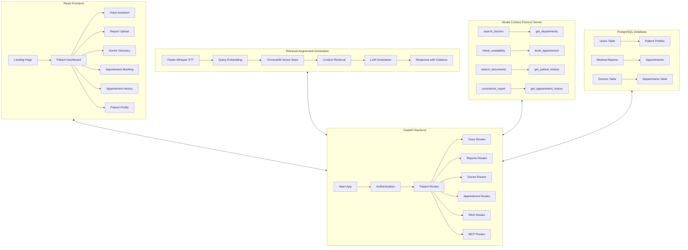
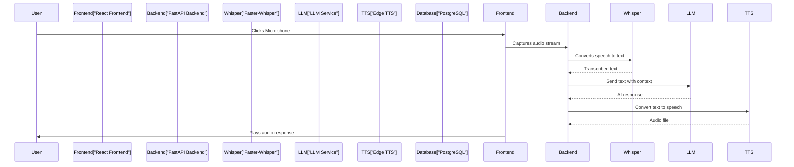
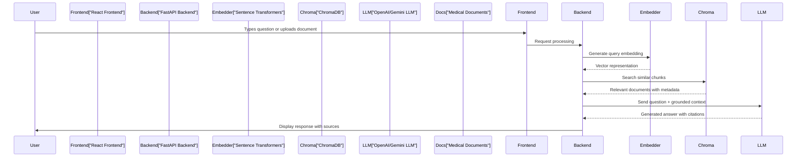
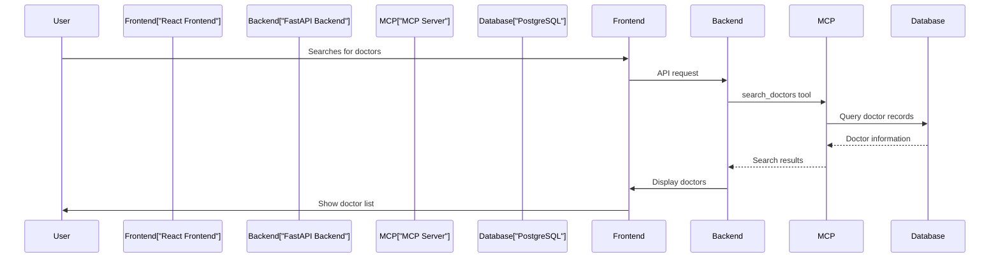
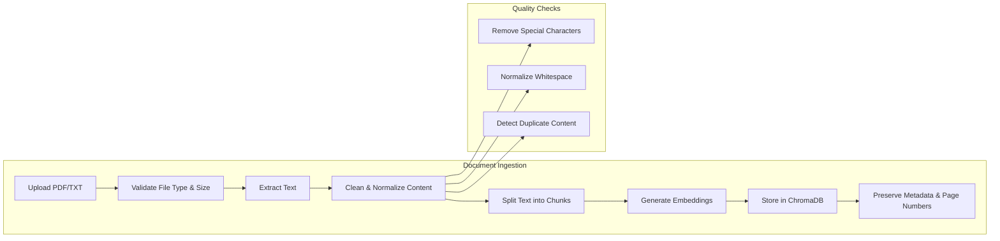
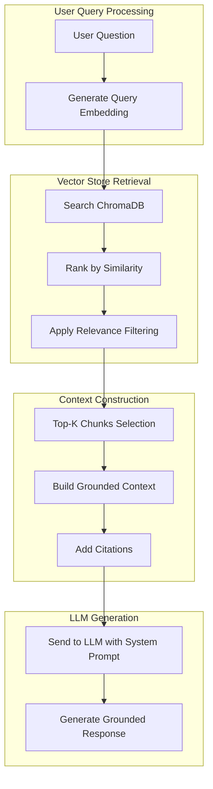

# MediVoice AI – Multilingual Voice-Based Healthcare Assistant


## Project Overview

**MediVoice AI** is a full-stack, AI-powered healthcare assistant that enables patients to communicate with an intelligent system using voice or text. Built as a professional AI Engineering portfolio project, it demonstrates practical implementation of modern Generative AI technologies including Large Language Models, Retrieval-Augmented Generation (RAG), Vector Databases, and Model Context Protocol (MCP).

The application supports English and Telugu languages, allows medical report upload and explanation, facilitates doctor searches and appointment booking, and provides a voice-based conversational interface while maintaining strict healthcare security and safety standards.

---

## Problem Statement

Modern healthcare faces several challenges:
- Limited access to medical information for patients
- Language barriers, particularly for non-English speakers
- Difficulty in understanding complex medical reports
- Challenges in finding appropriate healthcare providers
- Time-consuming appointment scheduling processes
- Patients often lack context about their own medical data

MediVoice AI addresses these problems by providing an accessible, multilingual, AI-powered assistant that bridges the gap between patients and healthcare information.

---

## Features

### Core Features

1. **Voice & Text Interaction**: Patients can communicate using microphone input or typed text
2. **Multilingual Support**: English and Telugu language support throughout the interface
3. **Speech-to-Text**: Using Faster-Whisper for accurate transcription
4. **Text-to-Speech**: Using Edge TTS for natural voice responses
5. **Medical RAG**: Retrieval-Augmented Generation using ChromaDB with trusted medical documents
6. **Medical Report Upload & Explanation**: Upload blood tests, CBC, lipid profiles, thyroid reports, etc.
7. **Doctor Directory**: Search doctors by specialization and department
8. **Appointment Management**: Check availability and book appointments
9. **Patient Authentication**: Secure JWT authentication with role-based access control
10. **Conversation History**: Maintain context across interactions

### AI-Powered Features

- **Medical LLM Assistant**: Context-aware responses with safety rules and disclaimers
- **RAG with Citations**: Every knowledge-based answer includes source references and page numbers
- **Emergency Detection**: Recognizes emergency language and escalates appropriately
- **Medical Report Extraction**: Parses test names, values, units, and reference ranges
- **Grounded Responses**: Answers based on retrieved medical knowledge, not hallucinations

### Administrative Features

- Role-based access control (Patient, Doctor, Administrator)
- Doctor and department management
- Appointment statistics and history
- Report management and tracking

---

## Technology Stack

### Backend
- **Python 3.12+** - Core language
- **FastAPI** - Modern API framework
- **SQLAlchemy** - ORM for database operations
- **Uvicorn** - ASGI server
- **PostgreSQL** - Primary database
- **Alembic** - Database migrations
- **JWT** - Authentication tokens

### LLM & AI
- **OpenAI GPT API** - Primary language model
- **Gemini API** - Alternative LLM provider
- **Faster-Whisper** - Speech-to-text
- **Edge TTS** - Text-to-speech
- **LangChain** - RAG pipeline

### Vector Database & RAG
- **ChromaDB** - Vector storage and similarity search
- **Sentence Transformers** - Embedding generation
- **PDFPlumber** - PDF text extraction

### MCP (Model Context Protocol)
- **FastMCP** - Python MCP SDK
- Custom tools for hospital operations:
  - `search_doctors`
  - `get_hospital_departments`
  - `check_appointment_availability`
  - `book_appointment`
  - `search_medical_documents`
  - `get_patient_history`
  - `summarize_medical_report`
  - `get_appointment_history`

### Frontend
- **React 18** - UI library
- **Vite** - Build tool and dev server
- **TypeScript** - Type-safe development
- **Lucide React** - Icon set
- **Recharts** - Data visualization
- **Material-UI (MUI)** - Component library

### Infrastructure
- **Docker** - Containerization
- **Docker Compose** - Multi-container orchestration
- **Environment Variables** - Configuration management
- **Git & GitHub** - Version control

---

## Architecture

### System Architecture Diagram



### Data Flow Diagrams

#### Voice Workflow



#### RAG Workflow



#### MCP Tool Workflow



---

## RAG Architecture

### Document Ingestion Pipeline



### Retrieval Pipeline



---

## Installation

### Prerequisites

- Python 3.12+
- Node.js 18+ (for frontend)
- PostgreSQL 15+
- Docker (optional, for containerized deployment)
- API keys for OpenAI and/or Google Gemini

### Backend Setup

1. **Clone the repository**
   ```bash
   git clone https://github.com/yourusername/medivoice-ai.git
   cd medivoice-ai
   ```

2. **Create a virtual environment**
   ```bash
   python -m venv venv
   source venv/bin/activate  # On Windows: venv\Scripts\activate
   ```

3. **Install dependencies**
   ```bash
   pip install -r backend/requirements.txt
   ```

4. **Set up environment variables**
   ```bash
   cp .env.example .env
   # Edit .env with your actual values
   ```

5. **Set up PostgreSQL**
   ```bash
   createdb medivoice_db
   # Or use Docker: docker run -e POSTGRES_DB=medivoice_db -e POSTGRES_USER=postgres -e POSTGRES_PASSWORD=postgres -p 5432:5432 postgres
   ```

6. **Initialize the database**
   ```bash
   cd backend
   alembic upgrade head
   # Or manually: python -c "from backend.database import create_db_and_tables; import asyncio; asyncio.run(create_db_and_tables())"
   ```

7. **Run the backend server**
   ```bash
   uvicorn backend.app.main:app --reload --host 0.0.0.0 --port 8000
   ```

### Frontend Setup

1. **Install Node.js dependencies**
   ```bash
   cd frontend
   npm install
   ```

2. **Set up API base URL**
   ```bash
   # Create .env file
   VITE_API_BASE_URL=http://localhost:8000
   ```

3. **Run the frontend development server**
   ```bash
   npm run dev
   ```

   The frontend will be available at `http://localhost:5173` (default Vite port).

### Docker Deployment

1. **Build and run with Docker Compose**
   ```bash
   docker-compose up --build
   ```

2. **Access the application**
   - Frontend: `http://localhost:3000`
   - Backend API: `http://localhost:8000`
   - API Documentation: `http://localhost:8000/docs`

### Docker Configuration

See `docker-compose.yml` for the complete container orchestration configuration including:
- Backend service (FastAPI + Uvicorn)
- Frontend service (Nginx + React)
- PostgreSQL database service
- ChromaDB persistent storage service

---

## API Documentation

### Authentication Endpoints

| Method | Endpoint | Description |
|--------|----------|-------------|
| POST | `/api/v1/auth/register` | Register new patient |
| POST | `/api/v1/auth/login` | Login and receive JWT token |
| GET | `/api/v1/auth/me` | Get current user information |

### Patient Endpoints

| Method | Endpoint | Description |
|--------|----------|-------------|
| GET | `/api/v1/patients/profile` | Get patient profile |
| PUT | `/api/v1/patients/profile` | Update patient profile |
| POST | `/api/v1/reports/upload` | Upload medical report |

### Doctor Endpoints

| Method | Endpoint | Description |
|--------|----------|-------------|
| GET | `/api/v1/doctors` | List doctors (filter by specialization) |
| GET | `/api/v1/doctors/{doctor_id}` | Get doctor details |
| GET | `/api/v1/doctors/departments/` | List hospital departments |

### Appointment Endpoints

| Method | Endpoint | Description |
|--------|----------|-------------|
| GET | `/api/v1/appointments` | List appointments |
| POST | `/api/v1/appointments` | Book new appointment |
| DELETE | `/api/v1/appointments/{appointment_id}` | Cancel appointment |

### Voice Endpoints

| Method | Endpoint | Description |
|--------|----------|-------------|
| POST | `/api/voice/transcribe` | Transcribe audio to text |
| POST | `/api/voice/speak` | Text to speech |
| POST | `/api/voice/chat` | Process voice conversation with LLM |

### RAG Endpoints

| Method | Endpoint | Description |
|--------|----------|-------------|
| POST | `/api/rag/ingest` | Ingest documents into knowledge base |
| POST | `/api/rag/query` | Query the medical knowledge base |
| GET | `/api/rag/sources` | Get available document sources |

### MCP Endpoints

| Method | Endpoint | Description |
|--------|----------|-------------|
| GET | `/api/mcp/doctors` | Search doctors by specialization |
| GET | `/api/mcp/departments/` | Get hospital departments |
| GET | `/api/mcp/appointments/availability` | Check appointment availability |
| POST | `/api/mcp/appointments/book` | Book appointment (requires confirmation) |
| POST | `/api/mcp/medical-documents/search` | Search RAG knowledge base |
| POST | `/api/mcp/patient/history` | Get patient history |
| POST | `/api/mcp/reports/summarize` | Summarize medical report |
| GET | `/api/mcp/appointments/history` | Get appointment history |

Full API documentation with request/response schemas is available at `/docs` when the backend is running.

---

## Testing

### Running Tests

```bash
# From the backend directory
cd backend
pytest

# Or run specific test categories
pytest tests/test_auth.py -v
pytest tests/test_rag.py -v
pytest tests/test_voice.py -v
pytest tests/test_reports.py -v
pytest tests/test_appointments.py -v
```

### Test Coverage

The test suite covers:
- **Authentication**: Registration, login, JWT token validation, password hashing
- **API Endpoints**: All REST endpoints with valid and invalid inputs
- **Voice Transcription**: Faster-Whisper integration tests
- **LLM Integration**: Response generation with various prompts
- **RAG Retrieval**: Vector search, similarity scoring, citation generation
- **MCP Tools**: Doctor search, appointment booking, report summarization
- **Access Control**: Role-based access verification
- **Medical Report Extraction**: Test value parsing and range checking
- **Emergency Escalation**: Emergency keyword detection and response

### Evaluation Metrics

- **RAG**: Recall@K, Precision@K, Context relevance, Faithfulness, Answer relevance
- **Voice**: Word Error Rate (WER), Response latency, Telugu transcription accuracy
- **Performance**: LLM response time, Retrieval latency, MCP tool execution time, Total conversational response time

---

## Security & Safety

### Healthcare Security Principles

MediVoice AI is designed with **privacy-by-default** principles and complies with healthcare data protection regulations:

1. **No Real Patient Data**: All development uses anonymized, synthetic data only
2. **Encryption**: sensitive data encrypted in transit (HTTPS/TLS) and at rest (database encryption)
3. **Password Hashing**: Using PBKDF2/BCrypt with secure salts
4. **Role-Based Access Control**: Patients access only their own records; doctors access authorized records
5. **JWT Authentication**: Short-lived tokens with secure signing
6. **Audit Logging**: All sensitive actions logged without PHI
7. **Session Expiration**: Automatic logout after inactivity

### Mandatory Safety Rules

- ⚠️ **Never independently diagnose diseases**
- ⚠️ **Never prescribe medications or recommend changing treatments**
- ⚠️ **Always provide clear medical disclaimers**
- ⚠️ **If emergency symptoms detected, immediately escalate to emergency services**
- ⚠️ **Never claim the system is clinically validated**
- ⚠️ **When unreliable information, say so rather than inventing**
- ⚠️ **Provide references for medical information when available**
- ⚠️ **Ask clarifying questions when necessary**
- ⚠️ **Recognize when professional medical advice is required**
- ⚠️ **Do not delay emergency escalation for an LLM response**

### Emergency Escalation

When the system detects emergency-related language (chest pain, heart attack, stroke, difficulty breathing, severe bleeding, anaphylaxis, poisoning, unconscious), it provides this exact message:

```
⚠️ EMERGENCY DETECTED: If you are experiencing a medical emergency, 
please call 911 (or your local emergency number) immediately. 
Do not wait for this assistant's response.
```

Then the system immediately directs users to emergency services without providing any further medical advice.

---

## Future Enhancements

### Planned Features

1. **Multilingual Expansion**: Add more Indian languages (Tamil, Hindi, Bengali, etc.)
2. **Medication Reminders**: Automated medication adherence notifications
3. **Integration with Wearables**: Apple Watch, Fitbit, and other health device data
4. **Telehealth Video Calls**: Integrated video consulting with real doctors
5. **Advanced Report Analysis**: AI-powered trend analysis across multiple lab reports
6. **Family/Caregiver Access**: Authorized family members can view patient summaries
7. **Medical Billing Integration**: Insurance claim assistance and billing support
8. **Analytics Dashboard**: Aggregated, anonymized population health insights

### Technical Improvements

- **Fine-tuned Medical LLM**: Domain-specific model fine-tuning for better accuracy
- **Hybrid Search**: Combine vector search with keyword search for improved retrieval
- **Real-time Embeddings**: Update vector store in real-time as new documents are added
- **Confidence Scoring**: LLM confidence indicators for generated responses
- **Audio Quality Enhancement**: Noise cancellation and audio preprocessing
- **Federated Learning**: Privacy-preserving model improvement from user interactions

---

## Project Structure

```
medivoice-ai/
├── backend/
│   ├── app/
│   │   └── main.py              # FastAPI application entry point
│   ├── config.py                # Configuration from environment variables
│   ├── database.py              # Database connection and table creation
│   ├── models/                  # SQLAlchemy models
│   │   ├── user.py
│   │   ├── patient_profile.py
│   │   ├── medical_report.py
│   │   └── appointment.py
│   │   └── doctor.py
│   ├── schemas/                 # Pydantic models for validation
│   │   ├── user.py
│   │   ├── appointment.py
│   │   ├── medical_report.py
│   │   ├── voice.py
│   │   ├── mcp.py
│   │   └── rag.py
│   ├── api/                     # REST API routers
│   │   ├── auth.py
│   │   ├── patients.py
│   │   ├── doctors.py
│   │   ├── appointments.py
│   │   ├── voice.py
│   │   └── reports.py
│   ├── ai/                      # AI services
│   │   ├── llm_service.py       # LLM communication
│   │   └── medical_agent.py     # Agent workflow orchestration
│   ├── rag/                     # Retrieval-Augmented Generation
│   │   ├── ingest.py            # Document ingestion
│   │   ├── embeddings.py        # Embedding generation
│   │   ├── retriever.py         # Vector search
│   │   └── vector_store.py      # ChromaDB interface
│   ├── mcp/                     # Model Context Protocol server
│   │   ├── server.py            # MCP tools implementation
│   │   └── tools.py             # Individual tool definitions
│   ├── security/                # Authentication and authorization
│   └── tests/                   # Pytest test suite
│
├── frontend/
│   ├── src/
│   │   ├── components/          # React components
│   │   ├── pages/               # Page components
│   │   ├── services/            # API services
│   │   ├── hooks/               # Custom React hooks
│   │   ├── context/             # React context providers
│   │   ├── styles/              # CSS/styled-components
│   │   ├── App.tsx              # Root component
│   │   └── main.tsx             # Entry point
│   ├── package.json             # npm dependencies
│   └── vite.config.ts           # Vite configuration
│
├── medical_documents/           # Trusted medical knowledge base documents
├── chroma_db/                   # Vector database persistence
├── .env.example                # Environment variables template
├── Dockerfile                  # Backend Docker configuration
├── frontend.Dockerfile         # Frontend Docker configuration
├── docker-compose.yml          # Multi-container orchestration
└── README.md                   # This file
```

---

## License

This project is licensed under the MIT License - see the [LICENSE](LICENSE) file for details.

---

## Contact & Contributing

**Project Maintainer**: AI Engineering Team

**Contributing**: We welcome contributions! Please read the contributing guidelines and submit pull requests for bug fixes, new features, or improvements.

**Issues**: Report bugs or feature requests at the GitHub Issues page.

**Disclaimer**: MediVoice AI is an informational healthcare assistant only. It does not provide medical diagnoses, prescriptions, or treatment recommendations. Always consult qualified healthcare professionals for medical advice.
